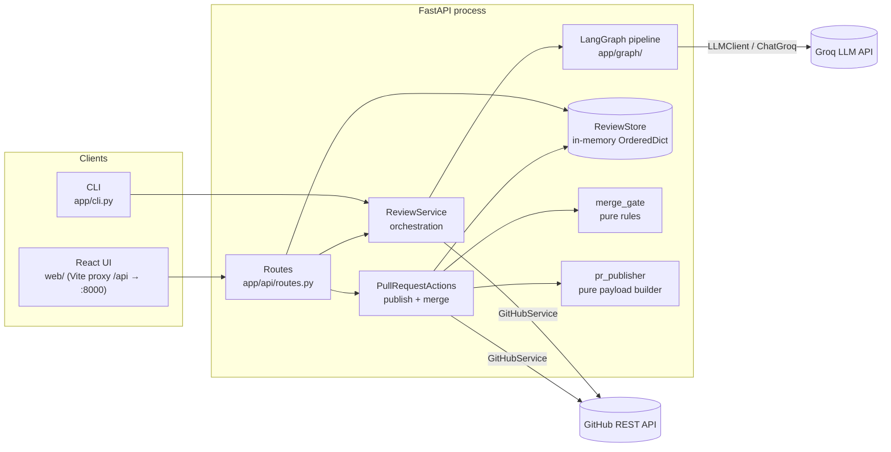
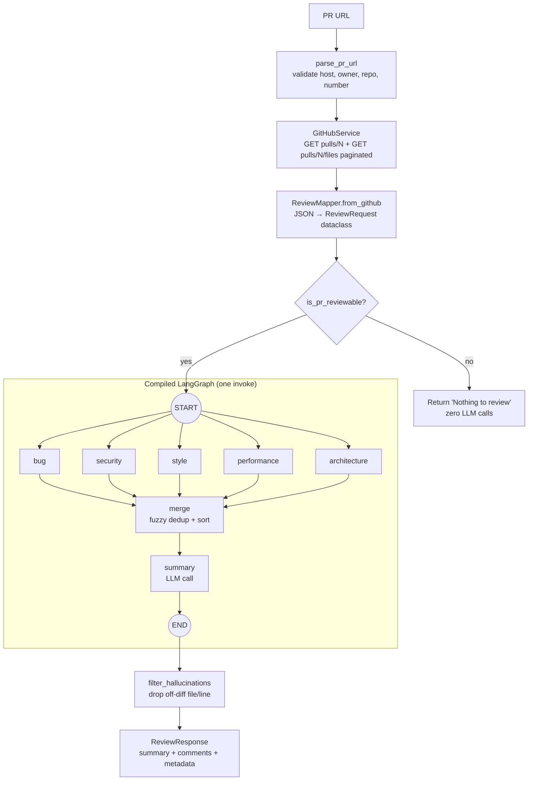
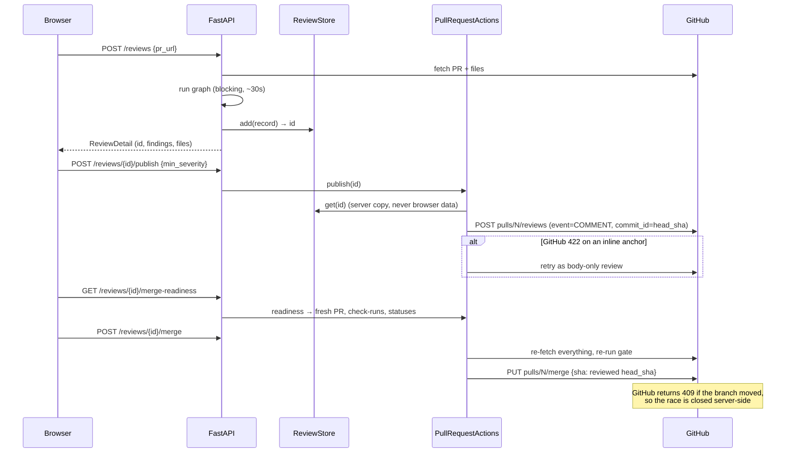

# AI Code Reviewer: Architecture Deep Dive

A study guide to how this project works today, read from three angles:

1. **HLD**: the boxes, the arrows, and the trust boundaries.
2. **LLD**: each module, its data structures, and one review traced call by call.
3. **The framework underneath**: every LangGraph/LangChain abstraction the code uses,
   rewritten as ordinary Python, so nothing is magic.

The last section maps the roadmap in `PLAN_code_reviewer_Ai.md` onto the same mental model.

> Written against the working tree on branch `feature/test-pr` (2026-10-23), with
> `langgraph==1.2.10`, `langchain-core==1.5.2`, `langchain-groq==1.1.3`. Statements
> marked **(verified)** were checked by running small probe graphs against these versions.

---

## Part 1: High-level design (HLD)

### 1.1 What the system does, in one paragraph

You give it a GitHub pull request URL. It downloads the PR's metadata and the diff of
every changed file. It sends that diff to **five specialist LLM "agents"** (bug,
security, style, performance, architecture). They run **in parallel**, each returning a
list of findings as JSON. A **merge** step removes duplicates and sorts by severity. A
**summary** agent writes an executive summary of the merged findings. A validation step
then drops any finding that points at a file or line that is not in the diff (a
"hallucination"). You get the result back. Optionally you can **publish** it to GitHub
as inline review comments with one-click "suggested changes", and, if a strict set of
gate checks pass, **merge** the PR.

### 1.2 Component diagram



Two entry points share one core:

| Entry point | File | What it calls |
|---|---|---|
| CLI: `review <url> [--publish]` | `app/cli.py` | `ReviewService().review_pr_url(...)` |
| Legacy REST: `POST /api/v1/review` | `app/api/routes.py` | same, returns findings, nothing stored |
| Session REST: `POST /api/v1/reviews` and friends | `app/api/routes.py` | `fetch_request` + `review`, then `ReviewStore.add` |

### 1.3 The review pipeline (the core)



LLM calls per review today: **6** (5 reviewers + 1 summary), regardless of PR size,
because each reviewer receives the whole PR diff in one prompt (see 2.6, "the dead
per-file path").

### 1.4 Publish and merge flow



### 1.5 Design principles visible in the code

| Principle | Where it shows |
|---|---|
| **The browser is never trusted.** Publish and merge read the server's stored review, not values sent back by the UI. | `review_store.py` docstring, `pr_actions_service.py` |
| **Check twice, then let GitHub enforce atomically.** The gate runs on fresh data at merge time, and the merge is pinned to the reviewed SHA. | `PullRequestActions.merge`, `GitHubService.merge_pull_request` |
| **An LLM never approves or blocks.** Reviews are always posted as `COMMENT`. | `PullRequestActions.publish` |
| **Incomplete ≠ clean.** Any agent failure lands in `errors`; `complete` is `not errors`; CLI exits 2; the merge gate refuses. | `base_node.py`, `review_service.py`, `cli.py`, `merge_gate._check_complete` |
| **Pure functions for anything with rules.** Payload building and the merge gate do no I/O, so they're unit-tested exactly. | `pr_publisher.py`, `merge_gate.py` |
| **Importable without secrets.** Settings, LLM clients and the graph are built lazily. | `settings.get_settings` (`lru_cache`), `BaseNode.llm` property, `routes.get_review_service` |
| **Typed domain errors, mapped once to HTTP.** | `errors.py`, `routes._raise_http` |

### 1.6 State and storage today

| What | Where it lives | Lifetime |
|---|---|---|
| Config | `Settings` (pydantic-settings, from `.env`) | process |
| Graph | compiled once per `ReviewService` | process (`lru_cache` in routes) |
| A review in flight | the `ReviewState` dict inside one `invoke` call | one request |
| Completed reviews | `ReviewStore` (`OrderedDict`, cap 200, LRU-evicted) | until restart |

There is no database yet. Phase 5 replaces `ReviewStore` with Postgres.

---

## Part 2: Low-level design (LLD)

### 2.1 Layering

Dependencies point downward only:

```
api/            HTTP: schemas, routes, DI, error mapping
services/       orchestration + I/O: ReviewService, GitHubService, LLMClient,
                PullRequestActions, ReviewStore; pure: merge_gate, pr_publisher
graph/          LangGraph wiring: state, nodes, merge, summary, parser, builder
prompts/        string constants only
utils/          pure helpers: URL parsing, mapping, diff math, prompt building
models/         data shapes: dataclasses, pydantic models, enums
settings, errors, logging_config   cross-cutting
```

### 2.2 Data structures (the nouns)

| Type | Kind | Why that kind | Key fields |
|---|---|---|---|
| `ReviewFile` | `@dataclass(slots=True)` | built by our own code from trusted-ish GitHub JSON; no validation needed | `filename, status, patch, language, additions, deletions` |
| `ReviewRequest` | `@dataclass(slots=True)` | same | `title, description, files, owner, repo, pull_number, head_sha, ...` |
| `ReviewComment` | pydantic `BaseModel` | built from **LLM output**, which must be validated and coerced | `file, line, severity, category, message, suggestion, start_line, suggested_code, dedup_collapsed_count` |
| `FindingList` | pydantic `BaseModel` | the schema handed to the LLM for structured output | `comments: list[ReviewComment]` |
| `ReviewResponse` | dataclass | final output | `summary, comments, metadata` |
| `ReviewState` | `TypedDict` | the LangGraph state (see Part 3) | one key per agent output + `merged_comments, summary, errors` |
| `ReviewRecord` | dataclass + `threading.Lock` | a stored review; lock serialises publish/merge on the same review | `id, request, response, publication, merge` |
| `GateCheck`, `MergeReadiness` | frozen dataclasses | immutable results of pure rules | `key, passed, detail`; `.ready` |
| `Severity`, `Category`, `AgentName` | `StrEnum` | compare and serialise as plain strings | |

The split is deliberate: **dataclasses for data we create, pydantic for data an LLM
creates.** `ReviewComment`'s `field_validator`s are the defence layer: `"line": "15"`
becomes `15`, `"line": "around 15"` becomes `None`, `"severity": "critical"` becomes
`LOW`, `"category": "CODE_SMELL"` becomes `BUG`, messages are capped at 4000 chars.

### 2.3 One review, traced call by call

Using the session API (`POST /api/v1/reviews`):

1. **FastAPI** parses the JSON body into `CreateReviewRequest` (pydantic). It resolves
   `Depends(get_review_service)` (an `lru_cache` singleton) and `Depends(get_review_store)`.
   The route is a sync `def`, so FastAPI runs it in its threadpool.
2. **`ReviewService.fetch_request`**
   - `parse_pr_url`: `urlparse`, require `https` + `github.com`, split path, require
     `/<owner>/<repo>/pull/<digits>`, reject `.`/`..`. Raises `InvalidPRURLError`.
   - `GitHubService.get_pull_request` and `get_pull_request_files`: `httpx.Client`
     with explicit timeouts; path segments `quote(..., safe="")`'d; files paginated 100
     at a time until a short page. `_request` maps 404/401/403/429/405/409/422 to typed
     errors.
   - `ReviewMapper.from_github`: GitHub JSON → `ReviewRequest`; `FileAnalyzer` adds a
     language and +/- counts.
3. **`ReviewService.review`** ([review_service.py:54](../app/services/review_service.py))
   - `is_pr_reviewable`: if no file has a non-empty patch, return early. No LLM calls.
   - Build `initial_state` (a plain dict) and call `self.workflow.invoke(initial_state)`
     ([review_service.py:83](../app/services/review_service.py)).
4. **Inside the graph, superstep 1**: the five reviewer functions run **concurrently on a
   thread pool**. Each is a one-liner calling `BaseNode.execute`
   ([base_node.py:41](../app/graph/base_node.py)):
   - `PromptBuilder.build(request, current_file=None)`: PR title, description, then
     every file's patch passed through `annotate_patch`, which prefixes each `+`/context
     line with its new-file line number so the model can cite exact lines.
   - Try `llm.generate_structured(..., schema=FindingList)`. On any exception, fall back
     to `llm.generate(...)` plus `ReviewParser.parse_comments` (strip ``` fences,
     `json.loads`, fall back to regex-extracting a `[{...}]` array, validate each item).
   - If both fail, return `{output_key: [], "errors": ["<agent>: <exc>"]}`.
   - Apply the per-agent severity floor, then return `{output_key: comments}`.
5. **Superstep 2, `merge_node`** ([merge.py](../app/graph/merge.py)): concatenate the 5 lists, sort by
   `(severity, file, line, -len(message))`, then greedy O(n²) dedup. Two findings are
   the same if they share a file, their lines are within ±3 (or both `None`), and their
   messages are ≥ 0.65 similar by `difflib.SequenceMatcher`. The first (highest-severity)
   wins; it absorbs the duplicate's `dedup_collapsed_count` and borrows its
   `suggested_code` if it had none.
6. **Superstep 3, `summary_node`**: `SummaryPromptBuilder` groups the merged findings
   by category into a bullet list, with the instruction "do NOT identify new issues".
   One raw LLM call; `ReviewParser.parse_summary` accepts `{"summary": ...}` or plain text.
7. Back in `ReviewService.review`: `filter_hallucinations`
   ([diff_validator.py](../app/utils/diff_validator.py)) drops findings whose file is not in the PR, or whose
   line is not in any hunk's new side. It keeps the finding but drops its fix if a
   suggestion range doesn't sit within one hunk or exceeds 30 lines. Then it builds
   metadata (`severity_counts`, `category_counts`, `errors`, `complete = not errors`).
8. Route: `store.add(...)` (uuid id, LRU eviction) → `_detail(record)` → pydantic
   `ReviewDetail` → JSON.

### 2.4 Diff math (the fiddliest pure code)

A unified-diff hunk header `@@ -a,b +c,d @@` says "new-file lines start at `c`". Walking
the hunk body:

| Line prefix | Exists in new file? | Advance new-line counter? | Commentable on GitHub `side=RIGHT`? |
|---|---|---|---|
| `+` added | yes | yes | yes |
| ` ` context | yes | yes | yes |
| `-` removed | no | no | no |

`extract_hunk_lines` returns `list[set[int]]`, one set per hunk. That one structure
answers three questions:

- "Is this line commentable?" → `line in union(all hunks)`
- "Can this multi-line suggestion be posted?" → `set(range(start, end+1)) <= some_hunk`
- "Which number should the prompt show?" → `annotate_patch`, same walk

### 2.5 Publishing and the merge gate

- `build_review_payload` (pure): filter by `min_severity`. Each finding whose line is
  commentable becomes `{"path", "line", "side": "RIGHT", "body"}` (+ `start_line` for
  multi-line suggestions). Everything else goes into a "Findings not attached to a diff
  line" section of the body. Suggested code is wrapped in a ```` ```suggestion ```` fence;
  `_fence` makes the fence longer than any backtick run inside the code, so the code
  cannot close it early.
- `evaluate_merge_gate` (pure): seven `GateCheck`s: enabled, open/not draft, review
  complete, review current (`reviewed_sha == current head`), zero HIGH findings, GitHub
  says mergeable (`None` = still computing = fail), CI green across both the Checks API
  and legacy statuses. If the token can't read CI, a synthetic failing check is injected,
  so the gate **fails closed**.
- Concurrency: `ReviewStore` has a store-level lock for the dict and a **per-record lock**
  so two simultaneous publish or merge clicks on the same review serialise.

### 2.6 Known sharp edges (from reading the code)

These are mostly already tracked in the plan. Listed so the LLD is honest.

1. **The per-file path is dead** (plan §6, "The bug being fixed"). `current_file` is always
   `None`, so every reviewer gets the whole PR. Fine for small PRs; large PRs exceed
   context and TPM.
2. **Retry multiplication on LLM calls.** Each layer retries independently:
   - The Groq SDK under `ChatGroq` retries by itself (`max_retries` defaults to **2**,
     verified), so up to 3 HTTP attempts.
   - `tenacity` wraps that 3×.
   - If structured output fails, the fallback `generate` does the same again.

   Worst case is roughly 9 + 9 = **18 HTTP calls per agent**. Under a rate limit, this
   amplifies the problem. Phase 3's limiter should own retries in one place.
3. **GitHub 429/5xx retries never fire** (plan 1.14). `_request` converts
   `HTTPStatusError` into domain exceptions *inside* the `@retry` function, but the
   retry predicate only recognises raw `httpx` errors. Only transport errors and timeouts
   retry.
4. **LLM retry classification is by substring** (`"500" in str(exc)`), which can match
   unrelated text. Prefer exception types or status codes.
5. **Shared node instance across threads.** `nodes._node` is one `BaseNode` used by five
   concurrent threads. The lazy `llm` property can race and build two `LLMClient`s.
   Harmless today (stateless clients), but worth knowing before adding per-client state
   like a rate limiter.
6. **The join edge will bite in Phase 2**: see 3.6, gotcha B.

---

## Part 3: The framework underneath

The goal is to remove the mystery. Below, each abstraction gets three things: **what
you wrote**, **what it really is**, and **the plain-Python equivalent**.

### 3.0 Cheat sheet

| LangGraph / LangChain abstraction | Used at | Plain Python equivalent |
|---|---|---|
| `ReviewState(TypedDict)` | `graph/state.py` | a `dict` with documented keys; `TypedDict` is a type hint only, with no runtime checks |
| `Annotated[list, operator.add]` | `state.errors` | "when several writers update this key, combine with `old + new`" (a **reducer**) |
| plain key (no `Annotated`) | every other state key | "last write wins; **two writes in one step is an error**" |
| `StateGraph(ReviewState)` | `builder.py` | a builder object holding `nodes: dict[str, fn]` and `edges: list[(src, dst)]` |
| `add_node(name, fn)` | `builder.py` | `nodes[name] = fn` |
| `add_edge(a, b)` | `builder.py` | `edges.append((a, b))`: "after `a` finishes, schedule `b`" |
| `START`, `END` | `builder.py` | the sentinel strings `"__start__"` and `"__end__"` |
| node function | `nodes.py`, `merge.py`, `summary.py` | `def f(state: dict) -> dict`: read the full state, return a **partial update** |
| `builder.compile()` | `builder.py` | validate the graph, build per-key "channels", return a runnable `Pregel` object |
| `graph.invoke(state)` | `review_service.py:83` | a loop of **supersteps**: run all ready nodes in parallel on a thread pool, then apply their updates through reducers |
| `ChatGroq(...)` | `llm_client.py` | an object holding model name, temperature, API key and an HTTP client for Groq's OpenAI-compatible `/chat/completions` |
| `[("system", s), ("human", u)]` | `llm_client.py` | `[{"role": "system", ...}, {"role": "user", ...}]` |
| `model.invoke(messages)` | `llm_client.py` | one HTTP POST; returns `AIMessage` whose `.content` is the reply text |
| `model.with_structured_output(FindingList)` | `llm_client.py` | send the pydantic JSON Schema as a forced **tool/function call**, then `FindingList.model_validate(json.loads(tool_call.arguments))` |
| `Runnable` / pipe `\|` (LCEL) | inside `with_structured_output` | function composition: `parse(call_llm(x))` |
| `@retry(...)` (tenacity) | `llm_client.py`, `github_service.py` | `for attempt in range(3): try: ... except: if not retryable or last: raise; sleep(backoff)` |

### 3.1 State: a dict, plus a rule per key

```python
class ReviewState(TypedDict):
    request: ReviewRequest
    bug_comments: list[ReviewComment]
    ...
    errors: Annotated[list[str], operator.add]
```

At runtime, `TypedDict` is just `dict`. LangGraph reads the annotations once, at
`StateGraph(ReviewState)` time, and creates one **channel** per key. A channel is a tiny
object that knows how to accept updates. Two kinds appear in this project **(verified
from `graph.channels`)**:

| Channel class | Created for | Behaviour in plain Python |
|---|---|---|
| `LastValue` | every plain key | `value = update`; if it gets **2+ updates in one step**, raise `InvalidUpdateError` |
| `BinaryOperatorAggregate` | `errors` (`operator.add`) | `value = reduce(operator.add, updates, value)`, i.e. `old + u1 + u2 ...` |

Plain-Python model of a channel:

```python
class LastValue:
    def update(self, values: list):
        if len(values) > 1:
            raise InvalidUpdateError("Can receive only one value per step")
        if values:
            self.value = values[-1]

class BinaryOperatorAggregate:
    def __init__(self, op): self.op = op
    def update(self, values: list):
        for v in values:
            self.value = self.op(self.value, v)   # old + new
```

**Why this matters here:** the five reviewers run in the *same* step. They are safe only
because each writes a **different** key (`bug_comments`, `security_comments`, ...). But
any of them may also write `errors` on failure, so `errors` *must* have a reducer, and it
does. Also note the reducer is applied *on top of* the initial value, so `initial_state`
seeds `errors` with `[]` and appends grow from there **(verified)**.

### 3.2 Nodes: functions that return a diff, not a new state

```python
def bug_node(state: ReviewState) -> dict[str, Any]:
    return _node.execute(state, system_prompt=BUG_PROMPT, output_key="bug_comments")
```

A node receives a **snapshot** of the whole state and returns **only the keys it wants to
change**. LangGraph never lets a node mutate shared state directly. It collects the
returned dicts, and at the end of the step, feeds each key's values into that key's
channel. Think of it as "each worker returns a patch; the coordinator applies patches."

### 3.3 Edges, START, END: an adjacency list

```python
builder.add_edge(START, "bug")      # ×5
builder.add_edge("bug", "merge")    # ×5
builder.add_edge("merge", "summary")
builder.add_edge("summary", END)
```

This is just:

```python
edges = {
    "__start__": ["bug", "security", "style", "performance", "architecture"],
    "bug": ["merge"], "security": ["merge"], "style": ["merge"],
    "performance": ["merge"], "architecture": ["merge"],
    "merge": ["summary"],
    "summary": ["__end__"],
}
```

Internally each edge becomes a trigger channel (`branch:to:merge`, etc.). When `bug`
finishes, it writes to `branch:to:merge`, and any node whose trigger channel was written
becomes runnable in the **next** step.

### 3.4 `compile()` + `invoke()`: the superstep loop (Pregel / BSP)

`compile()` returns a `CompiledStateGraph`, which subclasses `Pregel` **(verified via
MRO)**. Pregel is Google's "bulk synchronous parallel" graph model. In plain terms:

> Repeat: find every node that was triggered last step, run them **all at once**, wait
> for **all** to finish, then apply their updates. Stop when nothing is triggered.

Here is **this project's graph rewritten with no LangGraph at all**. It behaves the same
for our graph:

```python
from concurrent.futures import ThreadPoolExecutor

NODES = {
    "bug": bug_node, "security": security_node, "style": style_node,
    "performance": performance_node, "architecture": architecture_node,
    "merge": merge_node, "summary": summary_node,
}
EDGES = { ... as above ... }
REDUCERS = {"errors": lambda old, new: old + new}   # everything else: last-value

def apply_updates(state: dict, updates: list[dict]) -> dict:
    state = dict(state)                       # nodes saw a snapshot; we build the next one
    by_key: dict[str, list] = {}
    for upd in updates:
        for k, v in upd.items():
            by_key.setdefault(k, []).append(v)
    for k, values in by_key.items():
        if k in REDUCERS:
            for v in values:
                state[k] = REDUCERS[k](state[k], v)
        else:
            if len(values) > 1:
                raise RuntimeError(f"{k}: two writes in one step")   # InvalidUpdateError
            state[k] = values[0]
    return state

def invoke(state: dict) -> dict:
    ready = set(EDGES["__start__"])
    with ThreadPoolExecutor() as pool:
        while ready and ready != {"__end__"}:
            runnable = sorted(n for n in ready if n != "__end__")
            snapshot = state
            futures = [pool.submit(NODES[n], snapshot) for n in runnable]   # parallel
            updates = [f.result() for f in futures]                         # barrier: wait for all
            state = apply_updates(state, updates)
            ready = {nxt for n in runnable for nxt in EDGES[n]}             # next superstep
    return state
```

Running this for our graph:

| Superstep | Runs | Writes | Concurrency |
|---|---|---|---|
| 1 | bug, security, style, performance, architecture | 5 distinct `*_comments` keys (+ `errors` via reducer) | **5 threads** |
| 2 | merge | `merged_comments` | 1 |
| 3 | summary | `summary` (+ maybe `errors`) | 1 |
| 4 | nothing triggered except END | stop | |

Two consequences:

- **Sync `invoke` uses threads, not asyncio.** A probe printed thread names
  `ThreadPoolExecutor-1_0`, `ThreadPoolExecutor-1_1`, and two 0.2 s sleeping nodes
  finished in 0.22 s total **(verified)**. That is why the §4b baseline saw "5 concurrent
  calls, all agents finishing within 270 ms." With `ainvoke` and `async def` nodes, the
  same loop would use `asyncio.gather` instead.
- **Every route call is threads inside a thread.** A sync FastAPI route runs in
  Starlette's threadpool, and the graph then opens its own pool. Phase 4.1 (async
  end-to-end) removes both layers.

### 3.5 What LangGraph features are *not* used (yet)

Knowing what is absent is as useful as knowing what is present:

| Feature | Plain-Python meaning | Used? | Plan phase that needs it |
|---|---|---|---|
| `add_conditional_edges(src, router_fn)` | `next = router_fn(state)`: an `if/else` choosing the next node | no | maybe: skip summary when 0 findings, verifier routing |
| `Send(node, payload)` | "spawn N copies of `node`, each with its own private input" (dynamic fan-out) | no | **2.1 per-file fan-out** |
| checkpointer (`MemorySaver`, Postgres saver) | after each superstep, `db.save(thread_id, state)`; resume from there | no | possibly Phase 5 (resume after crash) |
| interrupts / human-in-the-loop | pause the loop, persist, wait for input | no | not planned |
| streaming (`graph.stream`) | `yield` the updates after each superstep | no | **10.1 SSE progress** (`stream_mode="updates"` → `agent.completed` events) |
| subgraphs | a node that is itself a compiled graph | no | per-file subgraph is one way to do 2.1 |

### 3.6 Two gotchas, verified against this LangGraph version

**Gotcha A: two parallel writers on a plain key crash the run.**

```text
InvalidUpdateError: At key 'shared': Can receive only one value per step.
Use an Annotated key to handle multiple values.
```

Today this cannot happen because each agent owns its key. In Phase 2, when *N file
branches × 5 agents* all write `bug_comments`, every such key needs
`Annotated[list[ReviewComment], operator.add]`. That is exactly plan item 2.2.

**Gotcha B: separate `add_edge` calls into a join node fire it once per arriving branch, not once after all.**

The probe had `START → fast → m` and `START → slow1 → slow2 → m`, wired with two
separate `add_edge` calls. Result: **`m` ran twice** (once in step 2 after `fast`, again
in step 3 after `slow2`). With `add_edge(["fast", "slow2"], "m")` (list form), `m` ran
**once** **(verified)**.

In plain Python: separate edges mean `if any_parent_finished_last_step: run(m)`. The list
form means `if all_parents_have_finished: run(m)`. The list form is a *waiting* join
with its own barrier channel.

Today's graph is safe only because all five reviewers are exactly one step from START,
so they land in the same superstep. If Phase 2 inserts per-agent steps of different
depth (for example a verifier on some branches), `merge` and `summary` would run
twice, doubling the summary LLM call. Use the list form for the join:

```python
builder.add_edge(["bug", "security", "style", "performance", "architecture"], "merge")
```

### 3.7 LangChain: `ChatGroq`, messages, `invoke`

```python
self.model = ChatGroq(model=..., api_key=..., temperature=..., request_timeout=...)
response = self.model.invoke([("system", system_prompt), ("human", user_prompt)])
text = response.content
```

What happens, step by step:

1. `ChatGroq` is a pydantic model (config holder) that subclasses `BaseChatModel`, which
   implements the `Runnable` interface (`invoke`, `batch`, `stream`, `ainvoke`). It wraps
   the official `groq` SDK client, which is an `httpx` client with `max_retries=2` by
   default.
2. The tuples are converted to message objects: `("system", s)` → `SystemMessage(s)`,
   `("human", u)` → `HumanMessage(u)`.
3. Message objects are converted to the OpenAI-style wire format and POSTed.
4. The JSON reply is wrapped as `AIMessage(content=..., response_metadata=...,
   usage_metadata=...)`.

Equivalent without LangChain:

```python
import httpx

def generate(system_prompt: str, user_prompt: str) -> str:
    r = httpx.post(
        "https://api.groq.com/openai/v1/chat/completions",
        headers={"Authorization": f"Bearer {GROQ_API_KEY}"},
        json={
            "model": "openai/gpt-oss-120b",
            "temperature": 0.2,
            "messages": [
                {"role": "system", "content": system_prompt},
                {"role": "user", "content": user_prompt},
            ],
        },
        timeout=45,
    )
    r.raise_for_status()
    return r.json()["choices"][0]["message"]["content"]
```

> Side note for Phase 3.6 (token accounting): `response.usage_metadata` already carries
> `input_tokens` / `output_tokens`. `LLMClient.generate` currently discards it by
> returning only `.content`.

### 3.8 LangChain: `with_structured_output(FindingList)`

For `ChatGroq` the default `method` is **`"function_calling"` (verified)**. So:

```python
structured = self.model.with_structured_output(FindingList)
result = structured.invoke(messages)   # → FindingList instance
```

is roughly this composition (an LCEL `RunnableSequence`, i.e. `bound_model | parser`):

```python
# 1. "bind": attach a tool whose parameters are FindingList's JSON Schema, and force it
schema = FindingList.model_json_schema()
tools = [{"type": "function",
          "function": {"name": "FindingList", "parameters": schema}}]
tool_choice = {"type": "function", "function": {"name": "FindingList"}}

# 2. call the model (same POST as above, plus tools + tool_choice)
msg = post_chat(messages, tools=tools, tool_choice=tool_choice)

# 3. "parse": take the tool call's argument JSON and validate it
args = msg["tool_calls"][0]["function"]["arguments"]       # a JSON string
result = FindingList.model_validate(json.loads(args))     # runs ReviewComment validators
```

Why the code still has a fallback (`generate` + `ReviewParser`):

- Not every Groq-hosted model supports tool calling reliably (plan §2.2).
- If the model emits invalid arguments, step 3 raises, and the raw-text path with the
  tolerant parser gets a second chance.

The `|` pipe in LCEL is plain function composition: `(a | b).invoke(x)` ≡ `b(a(x))`.

### 3.9 Tenacity: a retry loop as a decorator

```python
@retry(retry=retry_if_exception(pred), stop=stop_after_attempt(3),
       wait=wait_exponential_jitter(initial=1, max=10), reraise=True)
def generate(...): ...
```

≡

```python
def generate_with_retry(*a, **kw):
    for attempt in range(1, 4):
        try:
            return generate(*a, **kw)
        except BaseException as exc:
            if not pred(exc) or attempt == 3:
                raise                                   # reraise=True: original exception
            delay = min(10, 1 * 2 ** (attempt - 1)) + random.uniform(0, 1)
            time.sleep(delay)
```

Because the predicate inspects the exception **after** the function body has run, any
`try/except` *inside* the body that converts the exception changes what the predicate
sees. That is the root cause of the GitHub-retry bug in 2.6 #3.

### 3.10 Non-LangChain "framework" pieces, demystified

| Abstraction | Plain Python |
|---|---|
| `pydantic.BaseModel.model_validate(d)` | `obj = cls(); for each field: v = run_before_validators(d.get(name)); check type; setattr` |
| `@field_validator(..., mode="before")` | a function run on the raw input before type checking: the "coerce" hook |
| `pydantic_settings.BaseSettings` | `os.environ` + `.env` file → validated object; `SecretStr` hides the value in `repr` |
| `@lru_cache(maxsize=1)` on a zero-arg function | a lazily created singleton: `if _x is None: _x = make(); return _x` |
| FastAPI `Depends(get_x)` | before calling the route, call `get_x()` (recursively resolving its own `Depends`) and pass the result in; tests override the function |
| sync `def` route | FastAPI runs it in a threadpool (`anyio.to_thread.run_sync`) so it doesn't block the event loop |
| `structlog.get_logger().info("event", k=v)` | build a dict `{"event": ..., "k": v, "timestamp": ..., "level": ...}` and print it as JSON |

---

## Part 4: The roadmap through the same lens

How the planned changes look as plain Python. These are the shapes to aim for, not
final code.

### 4.1 Phase 2.1: per-file map-reduce with `Send`

LangGraph shape (one version):

```python
def fan_out(state):                                   # conditional edge from START
    return [Send("review_file", {"request": state["request"], "current_file": f})
            for f in state["request"].files if f.patch]

builder.add_conditional_edges(START, fan_out, ["review_file"])
builder.add_edge("review_file", "merge")
```

where `review_file` runs the enabled agents for one file and returns
`{"bug_comments": [...], ...}`. With N files, that is N parallel writes to the same keys,
so **every comment key needs `operator.add`** (gotcha A).

The same thing in plain Python:

```python
def review(request):
    jobs = [(agent, f) for f in request.files if f.patch for agent in ENABLED_AGENTS]
    with ThreadPoolExecutor(max_workers=LIMIT) as pool:            # Phase 3.2 bound
        results = list(pool.map(lambda j: run_agent(*j), jobs))   # map
    all_comments = [c for r in results for c in r.comments]       # reduce (operator.add)
    errors = [e for r in results for e in r.errors]
    merged = merge(all_comments)
    return merged, summarize(merged), errors
```

`Send` is literally "`pool.submit(node, private_input)` for each item, then reduce the
outputs through the reducers." The definition of done in §6 ("one LLM call per (file ×
enabled agent)") is a `len(jobs)` assertion.

Decision you'll face: **one `Send` per file** (the node loops over agents) or **one
`Send` per (file, agent)** (maximum parallelism, simplest rate-limiting, cleanest
`agent_runs` rows). The second maps directly onto the Phase 5 `agent_runs` table.

### 4.2 Phase 2.3/2.4: one generic reviewer node + registry

Today: five functions closing over a prompt. Tomorrow:

```python
@dataclass(frozen=True)
class AgentConfig:
    name: str
    prompt: str
    model_tier: str
    enabled: bool
    severity_floor: Severity
    max_findings_per_file: int

REGISTRY: dict[str, AgentConfig] = load_yaml("agents.yaml")

def review_node(payload):                    # payload = {"agent": name, "file": f, ...}
    cfg = REGISTRY[payload["agent"]]
    ...
```

This is a strategy table: data selects behaviour, so adding an agent is a YAML entry.

### 4.3 Phase 3: rate limiting and budget

- Token bucket = `tokens = min(cap, tokens + rate * elapsed)`; `if tokens < cost: wait`.
  Two of them per model (requests/min, tokens/min).
- Bounded concurrency = `asyncio.Semaphore(n)` around each LLM call.
- Content-hash cache = `key = sha256(blob_sha + agent + model + prompt_version)`;
  `if key in cache: return cache[key]`.

None of these need LangGraph. They live in `LLMClient` (or the planned `LLMProvider`),
underneath the nodes. Fix the retry stacking (2.6 #2) at the same time: set
`ChatGroq(max_retries=0)` and let one layer own retries.

### 4.4 Phase 4/5: async + job queue

- `graph.ainvoke` + `async def` nodes: the superstep loop uses `asyncio.gather` in
  place of a thread pool.
- `POST /reviews` → insert a `jobs` row, return 202. Worker:
  `SELECT ... FOR UPDATE SKIP LOCKED LIMIT 1` (a lock-free work queue in SQL), run the
  same `review()`, write results.
- SSE (10.1) = iterate `graph.astream(state, stream_mode="updates")`. Each yielded item
  is `{node_name: update}`, which is exactly an `agent.completed` event.

### 4.5 Phase 7.1: verifier node

A new node between `merge` and `summary` (`merge → verify → summary`). In plain Python
it's `merged = [f for f in merged if verify(f, diff_of(f.file)).is_real]`. It is one more
LLM call per finding (or per file batch), which feeds back into the Phase 3 budget.

---

## Appendix: file map

| File | One-line role |
|---|---|
| `app/main.py` | FastAPI factory, lifespan (settings + logging), `/health` |
| `app/cli.py` | `review` command; exit 0 / 1 error / 2 incomplete |
| `app/settings.py` | pydantic-settings, lazy `get_settings()` |
| `app/errors.py` | typed domain exceptions |
| `app/logging_config.py` | structlog JSON/console config |
| `app/api/routes.py` | endpoints, DI providers, `_raise_http` mapping |
| `app/api/schemas.py` | HTTP request/response pydantic models |
| `app/services/review_service.py` | fetch → graph → hallucination filter → response |
| `app/services/github_service.py` | sync httpx GitHub client, retries, error mapping |
| `app/services/llm_client.py` | `ChatGroq` wrapper: `generate`, `generate_structured` |
| `app/services/review_store.py` | in-memory bounded store of reviews |
| `app/services/pr_actions_service.py` | publish (with 422 fallback) and merge |
| `app/services/pr_publisher.py` | pure: findings → GitHub review payload |
| `app/services/merge_gate.py` | pure: seven merge-readiness checks |
| `app/graph/state.py` | `ReviewState` TypedDict + `errors` reducer |
| `app/graph/builder.py` | graph wiring: fan-out, fan-in, summary |
| `app/graph/base_node.py` | shared reviewer logic: prompt, LLM, fallback, floor |
| `app/graph/nodes.py` | five thin reviewer nodes |
| `app/graph/merge.py` | fuzzy dedup + sort |
| `app/graph/summary.py` | summary node |
| `app/graph/parser.py` | tolerant JSON parsing of raw LLM text |
| `app/utils/diff_validator.py` | hunk math, line annotation, hallucination filter |
| `app/utils/prompt_builder.py` | reviewer user-prompt |
| `app/utils/summary_prompt_builder.py` | summary user-prompt |
| `app/utils/review_mapper.py` | GitHub JSON → `ReviewRequest` |
| `app/utils/github_parser.py` | PR URL validation |
| `app/utils/file_analyzer.py` | language detection, +/- counts |
| `app/prompts/*.py` | system prompts; `shared.py` holds output format + rules |
| `tests/fakes.py` | `FakeLLMClient`, `FakeGitHubService`: whole pipeline, no network |
| `eval/positive_control.py` | planted-defect recall check (§4b baseline) |
